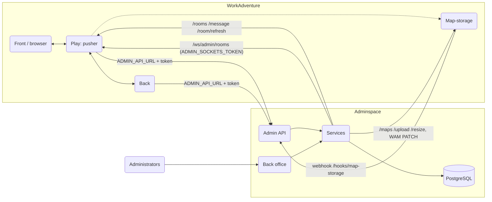
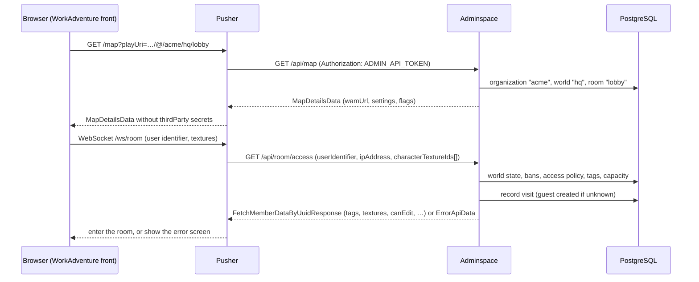
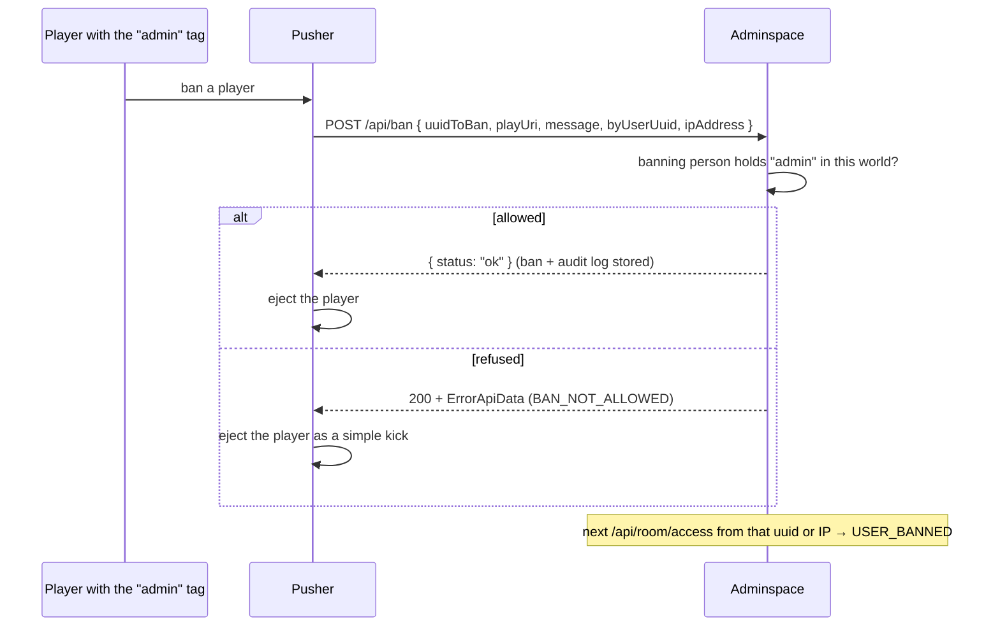
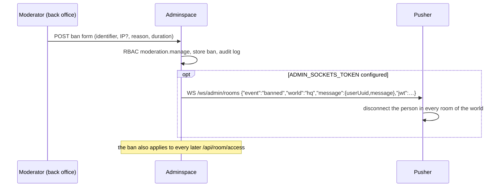

# Architecture

Adminspace is one SvelteKit (Node.js) application with two faces:

- the **Admin API** that WorkAdventure calls (`/api/*`, `/oauth/*`, `/white-label/*`), stateless and
  authenticated by `ADMIN_API_TOKEN`;
- the **back office** used by people (every other path), with server-side sessions and role-based
  access control;
- **webhooks** of WorkAdventure services (`/hooks/map-storage`), each authenticated by its own token
  (`mapStorageWebhookToken`): rooms created inside WorkAdventure are registered, deleted maps reported;
- the **Integration Center** (`src/lib/server/integrations/`, [INTEGRATIONS.md](INTEGRATIONS.md)): OAuth callbacks
  (`/integrations/oauth/{provider}/callback`), signed provider webhooks (`/integrations/webhooks/*`) and the automation
  API (`/automation/v1/*`, bearer tokens), all public, plus outgoing notifications run as background jobs.

Both share the PostgreSQL database and the service layer.



## Request flows

### Entering a room



### Ban from inside WorkAdventure



### Ban from the back office, with immediate disconnection



The JWT is signed with `ADMIN_SOCKETS_TOKEN` (HS256) and lists the room URLs the admin may act on
(`authorizedRoomIds`), as the pusher requires.

## Source layout

```
src/
  hooks.server.ts              locale negotiation, session, access guard, security headers
  lib/
    contract/workadventure/    WorkAdventure's zod schemas, vendored (npm run contract:sync)
    contract/adminApi.ts       contract shapes WorkAdventure defines in play/back
    i18n/                      locales (one module per area), negotiation, Intl formatting
    settings/                  zod schemas of world and instance settings (jsonb)
    components/                accessible UI building blocks
    server/
      config.ts                environment validation
      db/                      Drizzle schema and client
      auth/                    passwords, TOTP, sessions, RBAC
      adminApi/                Admin API router, route table, handlers, MapDetailsData builder
      services/                domain logic shared by the API and the back office
      integrations/            Integration Center: provider registry and adapters (providers/), OAuth, tokens,
                               events and deliveries, automation API, inbound webhooks, calendar and presence
      workadventure/           play URL parsing, ErrorApiData builders
      http/                    RFC 9457 problems, token check, form validation
      audit.ts, crypto.ts, context.ts
  lib/rooms/                   room sizes and office plans shared by pages and server (client-safe)
  routes/
    api/[...path]              Admin API entry (delegates to the router)
    hooks/map-storage          map-storage webhook (services/mapStorageWebhook.ts)
    integrations/oauth/[provider]/callback   OAuth redirect URI of every provider (session required)
    integrations/webhooks/     Slack Events API, GitHub and GitLab webhook receivers (signed)
    automation/v1/[...path]    automation API (Zapier, n8n, scripts)
    login, setup, logout, locale, profile, healthz, readyz
    (app)/                     back office (sidebar layout)
      worlds                   "My worlds"
      organizations
      o/[org]/                 organization: worlds, team, api-keys, domains, audit, settings,
                               room-sizes (bulk resize), office/new ("Create an office" wizard),
                               integrations (catalog, provider pages, notifications, deliveries, automation),
                               my-integrations (personal connections), presence ("Who's in", PRESENCE.md)
      o/[org]/w/[world]/       world: overview, live, rooms (room size panel), members, tags, moderation,
                               settings, activity, ready (after the wizard)
      admin/                   superadmin: status, organizations, accounts, catalog, settings, audit
      account                  profile, preferences, password, 2FA, sessions
drizzle/                       SQL migrations
scripts/                       migrate, seed, contract sync, i18n check, superadmin creation
tests/                         contract tests (database) and unit tests
```

Conventions:

- **Every action re-checks access.** SvelteKit does not run layout loads before form actions, so
  actions call `loadOrganization`/`loadWorld` with the permission they need (`src/lib/server/context.ts`).
  `hooks.server.ts` additionally refuses any back-office path without a session.
- **Every mutation is audited** with `audit()` (who, what, target, IP, UTC time), never with secrets.
- **No English in server answers to the back office**: actions return error _codes_
  (`common.errors.*`), pages translate them.
- **Admin API answers are typed with the contract** and checked by `tests/adminApi.contract.test.ts`.

## Data model

| Table                                          | Content                                                                                                  |
| ---------------------------------------------- | -------------------------------------------------------------------------------------------------------- |
| `accounts`                                     | back-office people: email, argon2id hash, superadmin flag, locale, time zone, TOTP, lockout              |
| `sessions`                                     | SHA-256 of session tokens, expiry, MFA state, IP, user agent                                             |
| `organizations`                                | slug (`/@/{slug}/…`), name, ISO 3166-1 country, BCP 47 default locale, contact, logo, color, status      |
| `organization_memberships`                     | account × organization × role (`owner`, `admin`, `moderator`, `viewer`, `employee`), status, inviter     |
| `workspaces`                                   | groups of worlds inside an organization (AdminSpace only; WorkAdventure URLs do not change), archive     |
| `workspace_memberships`                        | account × workspace × role (`manager`, `member`); requires the organization membership (composite FK)    |
| `invitations`, `invitation_workspaces`         | SHA-256 of single-use invitation tokens, email, role, workspace access, expiry, revocation, acceptance   |
| `signup_requests`, `password_resets`           | SHA-256 of registration and reset tokens (24 h / 30 min), single use                                     |
| `email_deliveries`                             | outcome of every email (sent, failed, not configured): purpose, recipient, error code; never the body    |
| `support_access_grants`                        | time-limited, justified support access of a platform administrator to one organization                   |
| `jobs`                                         | outbox of map-storage changes (links, template rooms, resizes): status, attempts, backoff, idempotency   |
| `worlds`                                       | slug, workspace, access policy, capacity, expiry, archive date, settings (jsonb, `WorldSettings`)        |
| `rooms`                                        | slug, map kind (`wam`/`tmj`), map URL, default flag, required tags, order, map-storage sync state        |
| `assets`                                       | content-addressed files (SHA-256) of components: bytes, media type, size, image dimensions               |
| `components`, `component_versions`             | catalog entries (platform or organization), immutable versions with their validated manifest             |
| `component_version_assets`                     | files of a version (path → asset)                                                                        |
| `component_installations`                      | component version installed in a world (composite FK keeps the world in the organization)                |
| `component_favorites`, `component_collections` | favorites and named collections of an account in an organization                                         |
| `members`                                      | people known in a world: WorkAdventure uuid, kind (`member`/`guest`), email, name, Woka, chat id, visits |
| `tags`, `member_tags`                          | tags of a world and who holds them                                                                       |
| `member_profiles`                              | employee profile per organization and email: job title, department, manager (self FK), work location     |
| `presence_reports`                             | Who's in: latest report of each pusher (people resolved to rooms, jsonb), valid until `expires_at`       |
| `bans`                                         | uuid and/or IP (`inet`), reason, author, expiry, revocation                                              |
| `reports`                                      | in-game reports and their handling                                                                       |
| `woka_collections`, `woka_textures`            | Woka catalog (ids kept identical to WorkAdventure's)                                                     |
| `companion_collections`, `companion_textures`  | companion catalog                                                                                        |
| `room_api_keys`                                | SHA-256 of Room API keys, organization/world scope, expiry, revocation                                   |
| `domains`                                      | custom domains, verification, challenge token                                                            |
| `instance_settings`                            | single row: connection to WorkAdventure and instance defaults (jsonb, `InstanceSettings`)                |
| `audit_logs`                                   | append-only log of changes                                                                               |
| `recording_events`                             | LiveKit egress results posted by the back                                                                |
| `analytics_events`                             | pseudonymous analytics of worlds that opted in                                                           |
| `integration_connections`                      | organization-wide or personal provider connections: status, granted scopes, sealed tokens, settings      |
| `integration_oauth_states`                     | SHA-256 of OAuth `state`, sealed PKCE verifier, 10-minute single-use flows bound to an account           |
| `integration_endpoints`                        | notification destinations: kind, sealed URL and signing secret, subscribed events, failure counters      |
| `integration_events`, `integration_deliveries` | events sent to destinations and the delivery log (attempts, answer, error); composite FKs per tenant     |
| `integration_inbound_events`                   | ids of inbound webhook deliveries already processed (replay protection, 7 days)                          |
| `automation_tokens`                            | SHA-256 of automation API tokens, scopes, creator, expiry, revocation                                    |

Primary keys are database-generated UUIDs, timestamps are `timestamptz` in UTC, and the database session
time zone is forced to UTC.

## Roles and permissions

One policy, in `src/lib/server/auth/rbac.ts`, decides every request: `organizationAccess()` derives the
tenant from the authenticated account and its **active** membership (never from a client-supplied id), and
`can(permission, { workspaceId })` answers for a resource scope. Every load and every form action calls
`loadOrganization()`/`loadWorld()` with the permission it needs.

Organization roles (`PERMISSIONS`):

| Permission                                                  | employee | viewer | moderator | admin | owner |
| ----------------------------------------------------------- | :------: | :----: | :-------: | :---: | :---: |
| `organization.read`, `directory.read`, `component.read`     |    ✓     |   ✓    |     ✓     |   ✓   |   ✓   |
| `team.read`, `workspace.read`, `world.read`, `member.read`  |          |   ✓    |     ✓     |   ✓   |   ✓   |
| `audit.read`                                                |          |   ✓    |     ✓     |   ✓   |   ✓   |
| `member.manage`, `moderation.manage`, `live.manage`         |          |        |     ✓     |   ✓   |   ✓   |
| `organization.update`, `team.invite`, `team.manage`         |          |        |           |   ✓   |   ✓   |
| `workspace.create`, `workspace.update`, `workspace.archive` |          |        |           |   ✓   |   ✓   |
| `world.create`, `world.update`, `room.manage`, `tag.manage` |          |        |           |   ✓   |   ✓   |
| `secrets.read`, `apiKey.manage`, `domain.manage`            |          |        |           |   ✓   |   ✓   |
| `component.install`, `component.manage`                     |          |        |           |   ✓   |   ✓   |
| `integration.manage`                                        |          |        |           |   ✓   |   ✓   |
| `integration.personal`                                      |    ✓     |   ✓    |     ✓     |   ✓   |   ✓   |
| `presence.view` (also workspace managers, not support)      |          |   ✓    |     ✓     |   ✓   |   ✓   |
| `organization.delete`, `ownership.transfer`, `world.delete` |          |        |           |       |   ✓   |

Workspace roles add rights **inside one workspace only** (`WORKSPACE_PERMISSIONS`): a `manager` reads and
administers the workspace's worlds (settings, rooms, members, tags, moderation, live, audit, component
installation) and its people; a `member` gets no back-office right (entry to the worlds, see below). Managers
never reach the team, integrations, secrets, ownership or other workspaces; moving a world to another
workspace needs the organization-wide `workspace.update`.

Who manages whom: owners manage everyone but owners; admins invite and manage employees, viewers and
moderators, never admins or owners (`grantableRoles`, `canManageMember`, re-checked under a row lock). Nobody
becomes or stops being an owner through a role change, a bulk action, an invitation, a suspension or a
removal: ownership changes hands only through the transfer, confirmed by the owner's password (or, for an
organization without owner, the platform's owner invitation). The last active owner cannot leave. Deleting
the organization asks for the owner's password again.

**Platform administrators** (superadmins) run the Control Center (`/admin/**`). They have **no right inside
an organization** by default: `/o/{org}` sends them to the organization's Control Center page. To help an
organization they start a support access (reason, 15/60/240 minutes), recorded in the organization's own
audit log; it grants `SUPPORT_PERMISSIONS` (reading, secrets excepted, and administering worlds, rooms, tags, moderation
and component installation) but never the team, workspace access, members' personal data (export, erasure,
edition), ownership, integrations, secrets (secret fields keep their value) or deletions, and every audit entry made meanwhile is tagged
`via: "support"`.

Organizations the account cannot see answer `404` rather than `403`, so slugs cannot be enumerated.

**Entering WorkAdventure**: in a members-only world, the people of the world's workspace (organization
staff, and employees who are members of that workspace) are admitted with their email, like listed
members; a suspended organization admits nobody (`ORGANIZATION_SUSPENDED`).

Rights **inside WorkAdventure** are separate: they come from the member's tags in the world (`admin` can
ban and edit maps, `editor` can edit maps by default, rooms can require tags), see the world's
_Permissions_ settings.
