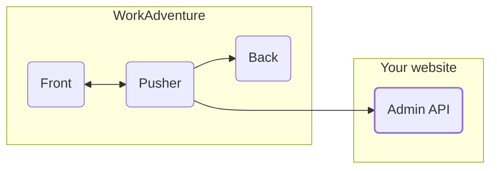
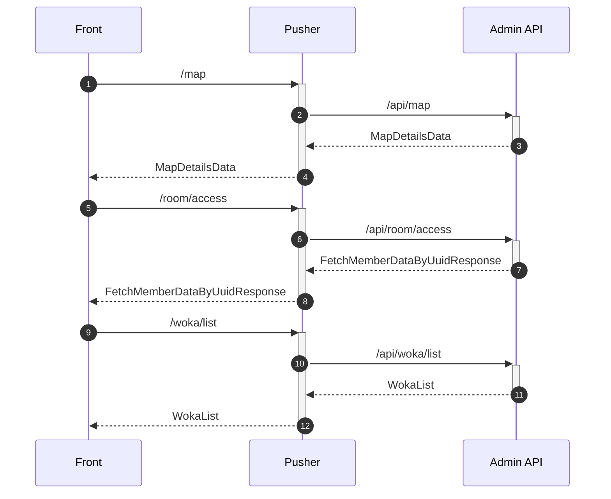

# Implement your own admin API
## Why
Create your own Admin API and connect it to WorkAdventure if:

- you want to connect WorkAdventure to your own database
- you want some of your users to have special privileges (tags)
- you want to create rooms dynamically
- you want to have "pretty URLs" for your rooms

:::caution
Be aware that WorkAdventure is licensed under "AGPL-3 restricted by the commons clause". It means in particular you are not allowed to sell a version of WorkAdventure online as a service. If in doubt, please contact us at hello@workadventu.re. We can offer special licenses depending on your use-case.
:::

## Architecture


First you need to understand how Work Adventure architecture is made.
WorkAdventure is divided in 3 sections :
- **Play**
    The play service served the game and is the one that centralizes the connections and makes exchanges through WebSocket tunnels with the clients of the Front.
    In addition, he speaks with the Back and the admin API if it's determinate.
- **Back**
    The back is the service that allows all metrics, movements, bubbles to persist.

Finally, the Admin API is the part where the members are managed. This part is fully optional.
If you are reading this documentation this is surely because you want to implement your own admin API.

## Principles
**Important!** It is not your site that will call the play service but the reverse.
The play service will directly ask your admin API for the information and authorizations it needs.



The most important endpoints are:
- `/api/map`
  _On the sequence diagram this is the call n°2._
  This end point maps the URL of the map to the map info (in particular the URL to the Tiled JSON file.
  It will process the playURI and the uuid to return the information of the map if the user can access it.
  In case of success, this endpoint returns a `MapDetailsData` object.
- `/api/room/access`
  _On the sequence diagram this is the call n°6._
  This end point returns the member's information if he can access this room.
  In case of success, this endpoint returns a `FetchMemberDataByUuidResponse` object.
- `/api/woka/list`
  _On the sequence diagram this is the call n°10._
  This end point returns a list of all the woka from the world specified.
  In case of success, this endpoint returns a `WokaList` object.

## What to do
1. You will need to implement, in your website, all the URLs that are listed in this swagger documentation : [WA Play](https://play.workadventu.re/swagger-ui/).
2. In the `.env` file :
   * Set the URL of your admin API, set the environment variable :
      `ADMIN_API_URL=http://example.com`
   * Set the token of the API to check if each request is authenticated by this token :
      `ADMIN_API_TOKEN=myapitoken`
      If the call is not correctly authenticated by the Bearer token in the header, make sure to answer with a 403 response.

## Optional: calendars, shared activity and presence

These optional endpoints let your admin bring what people connected in your back office into WorkAdventure, and know who
is connected. They are only
called when `GET /api/capabilities` lists them, and they are authenticated like the other endpoints (the
`ADMIN_API_TOKEN` in the `Authorization` header).

### `GET /api/calendar/events` (capability `"api/calendar/events": "v1"`)

Query parameters: `userIdentifier` (the user's UUID, the email of a signed-in user), `playUri` (the room), `from` and `to`
(ISO 8601, at most a week apart). The pusher asks for signed-in users only, every 5 minutes while they are in a room.

```json
{
  "connected": true,
  "provider": "google",
  "events": [
    {
      "id": "evt_123",
      "title": "Weekly sync",
      "start": "2026-10-24T09:00:00Z",
      "end": "2026-10-24T09:30:00Z",
      "allDay": false,
      "busy": true,
      "location": null,
      "joinUrl": "https://meet.example.com/abc"
    }
  ],
  "fetchedAt": "2026-10-24T08:55:00Z",
  "error": null
}
```

WorkAdventure shows the events in its agenda (with reminders and join buttons) and shows the user as _Busy_ while a
`busy` event that is not all-day is going on. `connected: false` hides the agenda; `error` (for instance `"expired"`)
tells why the calendar cannot be read. The schema is `isCalendarEventsData` in `libs/messages`. Never send calendar
tokens: only the events.

### `GET /api/presence/activity` (capability `"api/presence/activity": "v1"`)

Query parameter: `userIdentifier`. Answers what the user chose to share, if anything:
`{ "music": { "title": "…", "artist": "…" } | null, "coding": { "provider": "github", "repo": "…", "at": "ISO 8601" } | null }`.
Answer `null` for anything the user did not opt in to. The pusher asks for signed-in users only, every minute while they
are in a room, and the others see the answer in the menu that opens when they click the user.

### `POST /api/presence/report` (capability `"api/presence/report": "v1"`)

For a "who is in the office now" view. Each pusher sends the full list of the people connected to it, a few seconds after
someone joins, leaves or changes their status, and at least every `ttlSeconds / 3` even when nothing changes:

```json
{
  "instanceId": "pusher-7f3c2a-1b2c3d4e",
  "reportedAt": "2026-10-24T09:00:00.000Z",
  "ttlSeconds": 90,
  "users": [
    {
      "userIdentifier": "jane.doe@example.com",
      "name": "Jane",
      "isLogged": true,
      "playUri": "https://play.example.com/@/acme/hq/floor-1",
      "availabilityStatus": "BUSY",
      "connectedAt": "2026-10-24T08:12:00.000Z"
    }
  ]
}
```

A report replaces the previous report of the same `instanceId`. Forget a list that was not renewed within `ttlSeconds`:
its pusher stopped or cannot reach you. A pusher that shuts down sends an empty list. Answer `204`; a `404` makes the
pusher stop reporting. Unknown `availabilityStatus` values may come in the future: show them as online. The schema is
`isPresenceReportData` in `libs/messages`.

## Changing a map from your back office

When your back office changes a WAM file through the map-storage HTTP API (`PATCH`/`PUT` on `*.wam`, for instance to give
a desk to someone), map-storage tells the game servers, which read the file again and send the differences to the
players as ordinary edits: the people in the room see the change at once (a desk now belongs to someone, a chair was
removed), without reloading. Only changes that edits cannot carry (another map picture, settings, metadata, furniture
collections) make the players reload the map.
